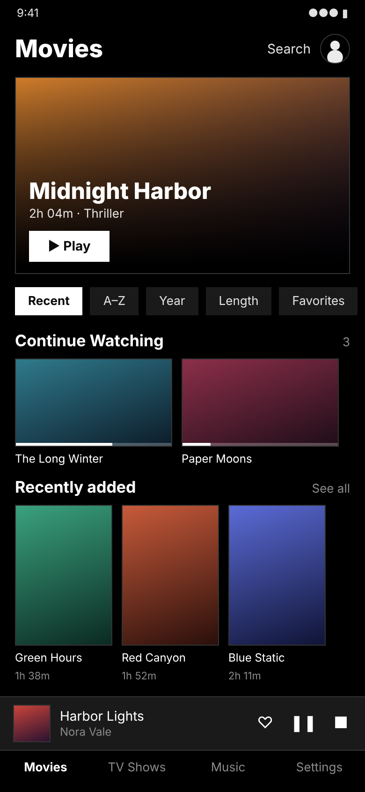
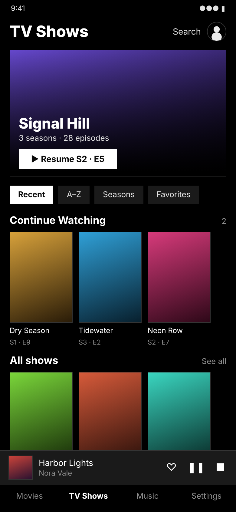
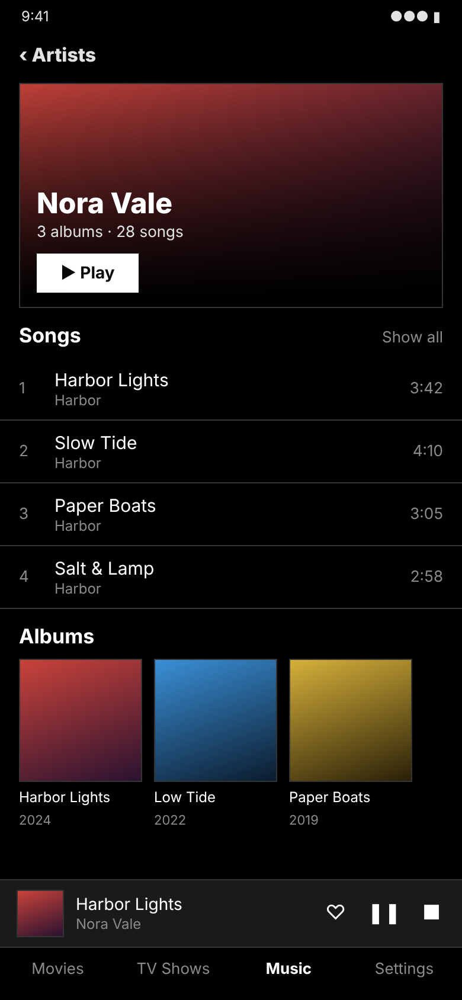
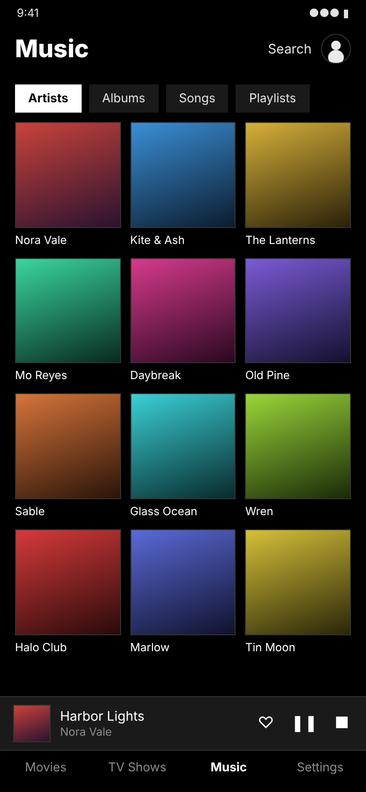
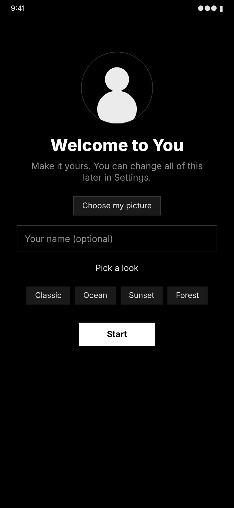
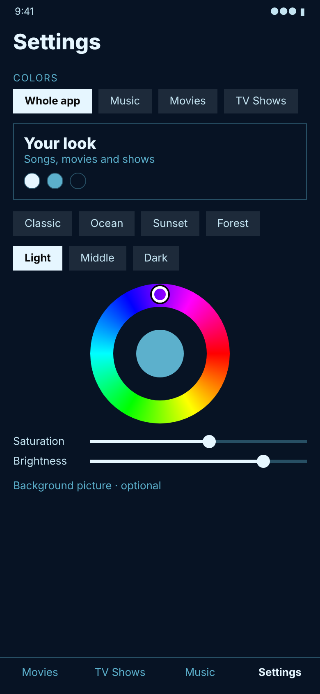
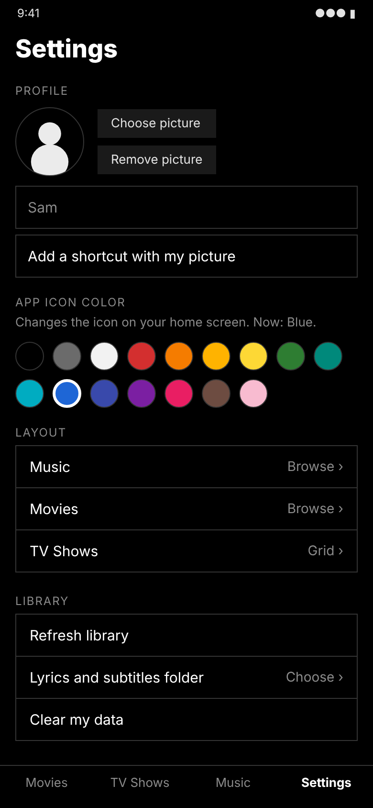
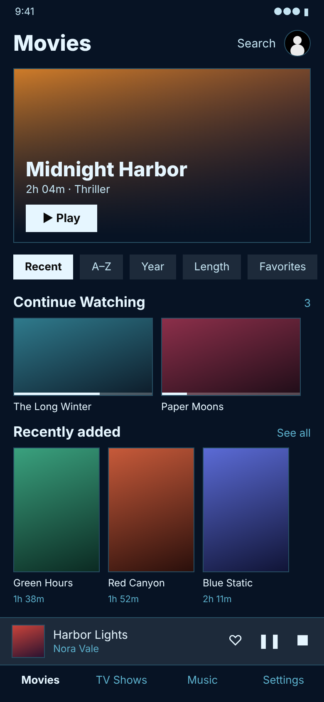
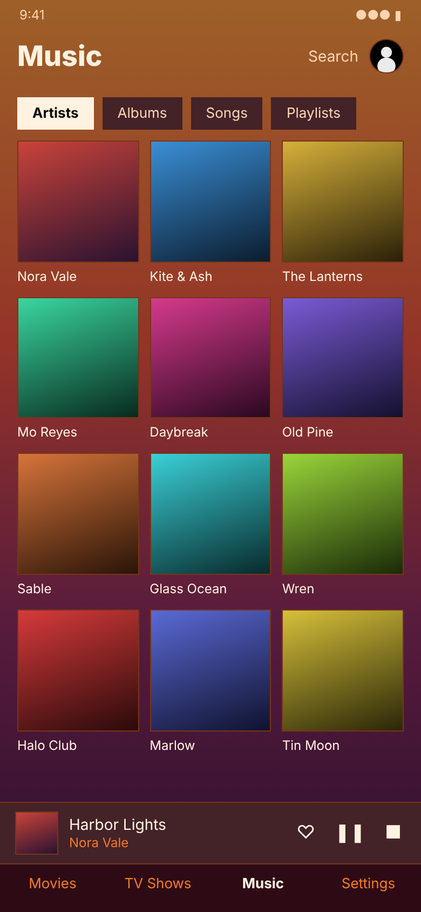

# You

Your **music, movies and TV shows**, on your phone and your PC. Fully offline and private, and made to look like you.

- **No internet permission.** Android itself blocks the app from going online. The Windows program has no networking code.
- **No ads, tracking, analytics or accounts.** Nothing is collected or shared.
- **Your files stay where they are.** The app only reads the music and videos already on your device.
- **Your own colors.** Pick any color for each of the three tones, or use a picture as the background.

## Screens

These are design previews of the real screens. Photos from a phone will replace them.

<table>
  <tr>
    <td></td>
    <td></td>
    <td></td>
    <td></td>
    <td></td>
  </tr>
  <tr>
    <td align="center">Movies</td><td align="center">TV Shows</td><td align="center">Artist</td><td align="center">Music (Grid)</td><td align="center">Welcome</td>
  </tr>
  <tr>
    <td></td>
    <td></td>
    <td></td>
    <td></td>
  </tr>
  <tr>
    <td align="center">Colors</td><td align="center">Profile and icon color</td><td align="center">Ocean look</td><td align="center">Picture background</td>
  </tr>
</table>

## Features

| Tab | What it does |
| --- | --- |
| **Movies** | Found automatically by file name. Poster from a video frame or your own picture, resume where you stopped, subtitles (.srt, .vtt), full screen, favorites, Continue Watching |
| **TV Shows** | Shows, seasons and episodes sorted automatically from file names, with the same posters, resume and subtitles |
| **Music** | Artists, albums, songs, playlists, favorites, synced lyrics (.lrc), cover art in the mini player |
| **Settings** | Profile picture and name, three-color theme with a color wheel, background picture, app icon color, Browse or Grid layout for each tab, Stop button, Clear my data |

**Browse** shows a big picture and rows. **Grid** shows a plain grid of covers. Each tab can use either.

## Progress

- [x] **Stage 1:** Music, Movies and TV Shows (copied from the private app this one comes from)
- [x] **Stage 2:** Your own colors: a color for each of the three tones, a background picture, a look for the whole app or for one tab
- [x] **Stage 3:** Profile picture and name, welcome screen, shortcut with your picture
- [x] **Stage 4:** App icon color (16 colors) on Android; icon color for the window, taskbar and shortcut on Windows
- [x] **Stage 5:** Android and Windows builds publish themselves on GitHub
- [x] Tested on a real phone (Android); the Windows build is also tested automatically
- [ ] Permanent signing key (see the end of this page)

## Download and install

### Android (Android 11 or newer)

1. On your phone, open the [latest release](https://github.com/Blackout-78/You/releases).
2. Find the newest release whose name starts with **You for Android**.
3. Tap **You.apk** to download it.
4. Open the downloaded file.
5. If your phone asks, allow your browser to **install unknown apps**.
6. Tap **Install**.
7. Open **You**.
8. Tap **Allow** when it asks to read your music and videos.

## Make it yours

1. Open **Settings**.
2. Under **Profile**, choose your picture and type your name.
3. Under **Colors**, tap **Light**, **Middle** or **Dark**, then drag on the color circle and the sliders.
4. To use a picture as the background, choose **Choose picture** and set **Dim picture** so the words stay easy to read.
5. To give Music, Movies or TV Shows its own colors, choose that name, then turn on **Use my own colors here**.
6. Under **App icon color**, tap a color dot to change the icon on your home screen.

## License

[MIT](LICENSE). Free to use, change and share.
